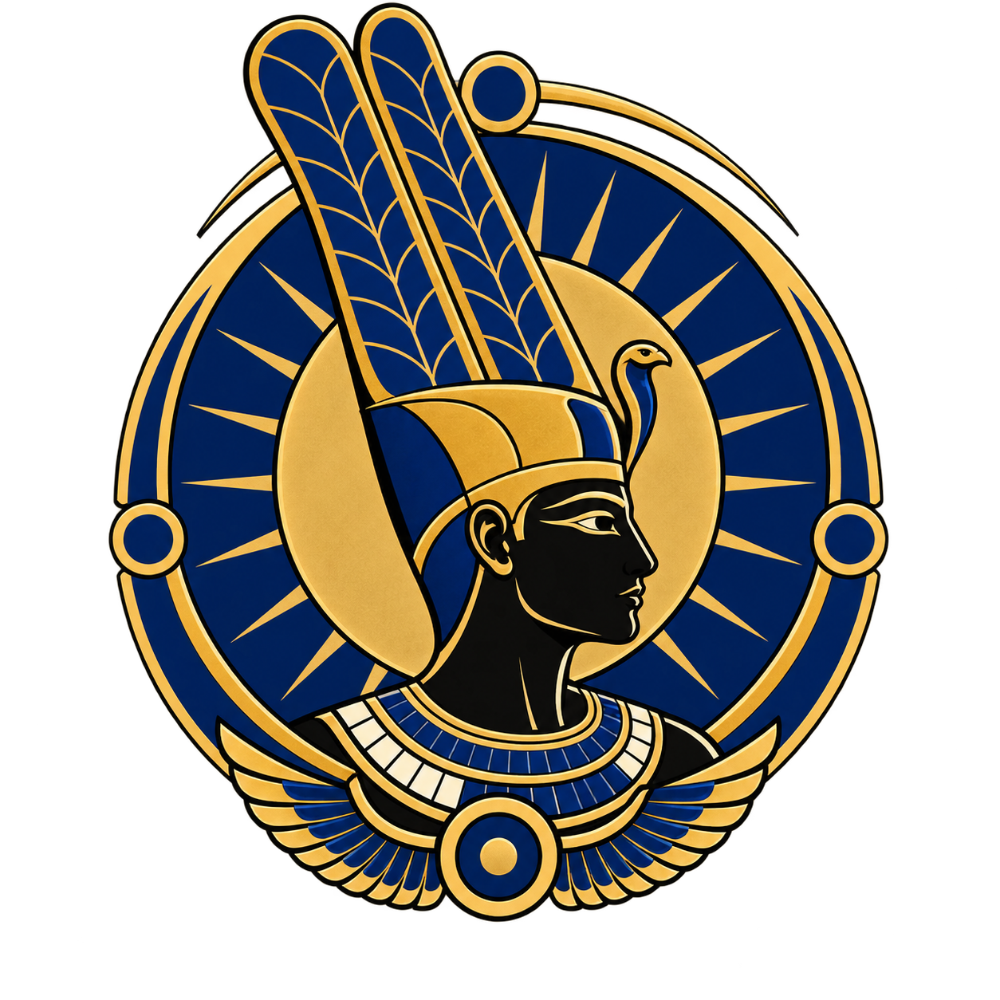

<p align="center">
  
</p>

# AMUN 3DS

**Achievements for native Nintendo 3DS games, offline, on real hardware.**

AMUN (Achievement Monitoring Underlaying Network) is a Luma3DS plugin that watches a game's
memory **read-only** and unlocks achievements you define, with toasts, a trophy badge, a
browsable list in the plugin menu, and a durable save-card ledger. There is no account and no
network: networking is compiled out of the console build.

> **Preview software.** AMUN is hardware-tested on one original (wedge) Nintendo 2DS with
> Mario Kart 7 EUR. Other consoles and games are untested. Read [SAFETY](docs/SAFETY.md)
> before installing, and prefer offline play.

## What you get

| Piece | What it is |
|---|---|
| **AMUN plugin** (`AMUN.3gx`) | The console side. Inert unless an exact-title achievement pack is present |
| **Mario Kart 7 set** | The demo set: 18 stable goals (coins and cups) plus an experimental race/ghost set |
| **AMUN Studio and CLI** | Desktop tools to write, test and build your own sets |
| **Docs and examples** | Profile format, condition language, a synthetic example set |

Mario Kart 7 is the showcase: it shows what a set looks like and how one is made, so you can
write your own. Sets are small JSON files; the compiler turns them into a bounded
`.amunpack` the console loads.

## Requirements

- A 3DS-family console running **boot9strap + Luma3DS** (v13.4 tested) with the plugin loader.
  AMUN does not help you hack a console; see the community guide at
  [3ds.hacks.guide](https://3ds.hacks.guide).
- A legally owned copy of the game. For the Mario Kart 7 set: **EUR region, build 3152**.
  AMUN checks the game's identity and does nothing on any other build.
- An SD card.

## Install the Mario Kart 7 set (players)

1. Download the latest `AMUN-3DS-v<version>.zip` from the
   [Releases](../../releases) page and check its SHA-256 against the release notes.
2. Open the zip's `sd-root` folder and copy its `luma/` and `amun/` folders onto the **root of
   your SD card**, merging with what is there. Back up an existing `/luma/plugins/default.3gx` first, because Luma loads only
   one default plugin.
3. Power on, hold **L + Down + Select** for the Rosalina menu, open *Plugin Loader* and enable it.
4. Launch Mario Kart 7. You should see an "AMUN observer running" notice.
5. Open the plugin menu (**L + SELECT** by default) > *Achievements* to see progress.

Logs are written to `/amun/logs/platform.log`; your unlocks live in
`/amun/ledger/`. Back that folder up if you care about your progress, and never delete it by hand.

Uninstall: delete `/luma/plugins/default.3gx` (and restore your backup). Your ledger stays
untouched.

## Make your own set

```sh
python amun.py profile validate profiles/synthetic
python amun.py profile test profiles/synthetic
python amun.py profile build profiles/synthetic -o build/synthetic.amunpack
python -m studio profiles/synthetic        # desktop editor
```

Start with [Creating achievements](docs/creating-achievements.md) and the
[profile format](docs/profile-format.md). Studio can find memory values for you with a read-only
Luma connection. Then read [CONTRIBUTING](CONTRIBUTING.md) to share it.

Host tools need Python 3.11+, CMake 3.20+ and a C++17 compiler; the Python tools use only the
standard library.

## Status

| | State |
|---|---|
| Original wedge 2DS, MK7 EUR 3152 | Hardware tested (coin goals unlock; load/exit regression passed) |
| Latest plugin changes (trophy badge, tick pacing) | Played on the original 2DS without problems; per-tick `perf:` timings not yet published |
| Cup goals | Table layout hardware-confirmed; per-goal unlocks still being confirmed |
| Race, ghost and Time Trial goals | Experimental research set |
| Old 3DS/XL, New 3DS/2DS XL | Not tested |
| Other games and regions | Possible with a new set; none shipped yet |

Detailed evidence: [engineering status](docs/engineering/status.md) and the
[project history](docs/history.md).

## Contributing

Sets, region ports, bug reports and hardware compatibility reports are all welcome. The most
useful single contribution is a **region or version port** of an existing set. See
[CONTRIBUTING](CONTRIBUTING.md) and the [set index](profiles/README.md).

## Safety, privacy and legal

- [docs/SAFETY.md](docs/SAFETY.md): ban risk, offline use, backups, removing the plugin.
- AMUN contains no Nintendo SDK, keys, firmware or game data. It is not affiliated with or
  endorsed by Nintendo. "Mario Kart" and "Nintendo" are trademarks of their owners and are used
  only to name the supported game.
- Code is [MIT](LICENSE). The console plugin statically links CTRPluginFramework under its own
  terms; see [THIRD_PARTY_NOTICES.md](THIRD_PARTY_NOTICES.md) and [LICENSES/](LICENSES/). The
  plugin is distributed free of charge with its source and patches.
- Achievement sets are separate works and declare their own license (the MK7 sets are CC0).

The Amun-inspired emblem is decorative project identity, not a claim of historical
reconstruction or affiliation. See [docs/brand.md](docs/brand.md).
